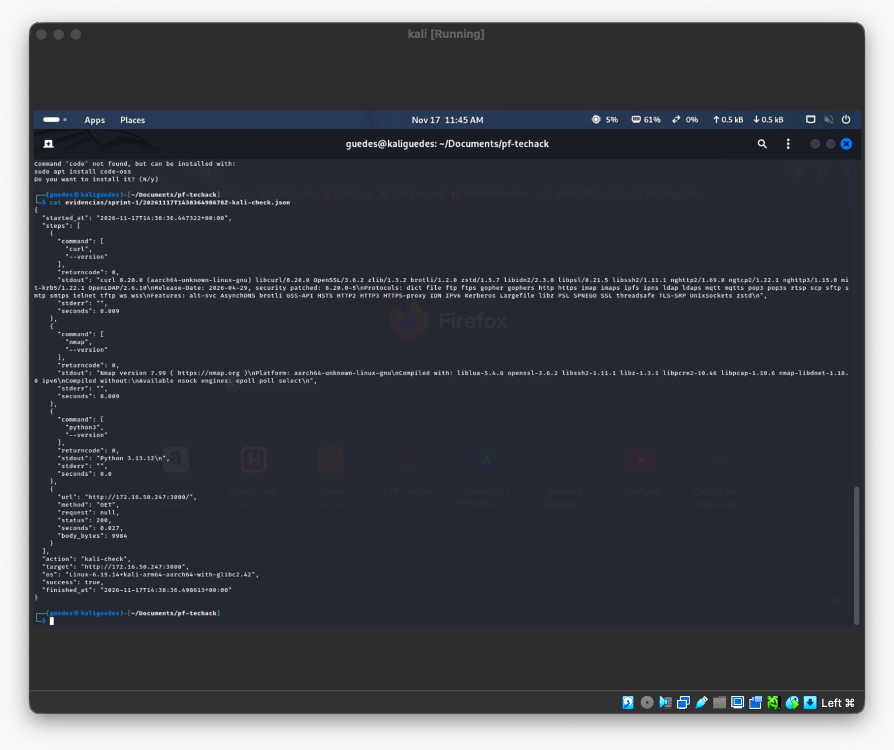

# Evidências da Sprint 1

Os registros abaixo documentam a preparação do laboratório em máquinas pessoais.
Os horários nos nomes dos JSONs estão em UTC. A data das execuções é 17/11/2026.

| Arquivo | Origem e resultado |
| --- | --- |
| [Primeira inicialização](20261117T140326841338Z-up.json) | Mac: falha durante a espera dos healthchecks; preservada para documentar a correção do caminho do Node. |
| [Inicialização validada](20261117T141229823136Z-up.json) | Mac: HTTP, inferência local e inventário concluídos com sucesso. |
| [Restauração](20261117T141308210590Z-reset.json) | Mac: novo contêiner, mesma imagem, marcador removido e zero desafios resolvidos. |
| [Verificação na LAN](20261117T142522280487Z-check.json) | Mac: HTTP no endereço `172.16.50.247:3000` e resposta do modelo local confirmados. |
| [Print do JSON no Kali](kali-check-json.png) | Captura original enviada pelo grupo, adicionada em 18/11/2026: HTTP 200, 9.986 bytes recebidos e `success: true`. |

A captura do Kali mostra o resultado do diagnóstico no terminal. Ela não é uma
captura da aplicação aberta no navegador nem substitui o arquivo JSON original.
O grupo confirmou que a interface abriu após desativar o proxy do Firefox.
O JSON original da VM e a captura da aplicação aberta continuam pendentes.

